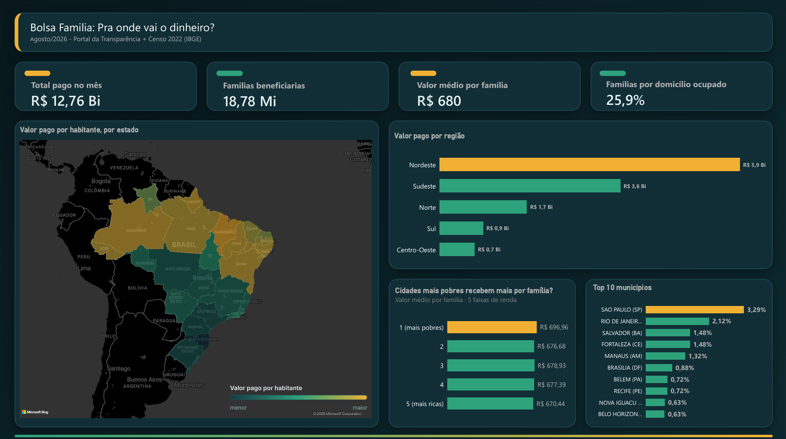

# Bolsa Família: para onde vai o dinheiro?

> 🚧 **Projeto em andamento.** Este README é atualizado conforme o trabalho avança. Veja o [diário de progresso](#diário-de-progresso) no final.

Análise de dados públicos do Bolsa Família por município e região do Brasil, cruzando os pagamentos do programa com dados demográficos e de renda do IBGE.



## Perguntas que o projeto quer responder

1. Qual a participação de cada município no total pago pelo programa e qual a cobertura (famílias beneficiárias por domicílio)?
2. Existe relação entre a renda por pessoa de um município e o valor médio recebido por família?
3. Quais municípios têm valor por pessoa ou por família muito acima da média nacional, e o que os dados sugerem sobre o motivo?
4. Como o valor pago e a cobertura se distribuem entre regiões e estados, e quão concentrado é o dinheiro entre os municípios?

## Fontes de dados

| Fonte | O que traz | Link |
|---|---|---|
| Portal da Transparência (CGU) | Pagamentos do Novo Bolsa Família, uma linha por beneficiário (agosto/2026) | https://portaldatransparencia.gov.br/download-de-dados |
| IBGE (SIDRA), tabela 9728 | Domicílios particulares permanentes ocupados e moradores por município (Censo 2022) | https://sidra.ibge.gov.br/tabela/9728 |
| IBGE (SIDRA), tabela 10295 | Rendimento domiciliar mensal per capita, médio e mediano, por município (Censo 2022) | https://sidra.ibge.gov.br/tabela/10295 |
| Portal Brasileiro de Dados Abertos | Tabela de correspondência entre código SIAFI e código IBGE dos municípios | https://dados.gov.br |

> Período analisado: agosto/2026 (um único mês)
>
> Os valores são nominais (sem correção pela inflação).

## Ferramentas

- **Python** (pandas) para leitura, tratamento leve e junção de tabelas de domínio.
- **DuckDB (SQL) e Parquet** para processar o arquivo massivo de pagamentos (cerca de 2 GB, 18,8 milhões de linhas) com alta performance sem sobrecarregar a memória RAM.
- **Power BI** para os gráficos, o mapa e o dashboard final (tema escuro, com medidas DAX).
- **Git e GitHub** para versionar e apresentar o projeto.

## Estrutura do projeto

```
bolsa-familia-ibge/
├── dados/                      # Arquivos brutos (CSVs, Parquets) e a base final municipio_final.parquet (ignorado no Git)
├── scripts/                    # Pipeline ETL modularizado
│   ├── 01_processar_ibge.py    # Extração e normalização dos dados do SIDRA/IBGE
│   ├── 02_processar_siafi.py   # Resolução de divergências SIAFI x IBGE via Fuzzy Matching
│   ├── 03_processar_bf.py      # Agregação massiva de pagamentos do Bolsa Família via DuckDB
│   └── 04_consolidar_final.py  # Cruzamento das bases, cálculo de métricas e exportação
├── dashboard/                  # Arquivo do Power BI (.pbix), tema (.json) e imagens do dashboard
├── main.py                     # Script orquestrador do pipeline de ponta a ponta
└── README.md
```

## Metodologia e decisões

**Conversão.** O CSV de pagamentos (separador `;`, codificação latin-1) foi convertido para Parquet. Na conversão, CPF e nome dos beneficiários foram descartados. Ficaram só o mês de competência, o mês de referência, a UF, o código e o nome do município, o NIS (usado apenas para contar famílias distintas) e o valor da parcela. Nenhum dado pessoal é publicado neste repositório, apenas totais agregados por município.

**Conferência dos dados (agosto/2026).**

| Verificação | Resultado |
|---|---|
| Linhas no arquivo | 18.809.420 |
| NIS distintos | 18.778.328 |
| Total pago | cerca de R$ 12,76 bilhões |
| Municípios | 5.571 (o Censo 2022 tem 5.570) |
| UFs | 27 |
| Valor da parcela | mínimo R$ 25, mediana R$ 650, média R$ 678,56, máximo R$ 4.040 |
| Linhas com valor acima de R$ 2.000 | 4.937 (cerca de 0,03%) |

**Decisões tomadas e arquitetura ETL.**

- **Mês de referência.** 99,84% das linhas se referem a agosto. Os 0,16% restantes (referência de janeiro a julho) foram mantidos.
- **Contagem de famílias.** Usa `COUNT(DISTINCT nis)`. Cerca de 12 mil NIS (0,06%) aparecem em mais de uma linha.
- **Linhas sem NIS.** São 321 linhas (R$ 231.729). Entram no total pago, mas ficam fora da contagem de famílias.
- **Valores altos.** Foram mantidos. São raros e não há indício de erro.
- **Valor médio por família.** Calculado como total pago às famílias dividido pelo número de famílias distintas, e não como média das linhas.
- **Cruzamento SIAFI × IBGE (automatizado).** A tabela do SIAFI possui 5.589 linhas, sendo 19 marcadores descartados (`0000000`). Para ligar os municípios do SIAFI aos do IBGE, usa-se uma rotina de *Fuzzy Matching* (`difflib.SequenceMatcher`) no script `02_processar_siafi.py`, que resolveu as divergências de grafia dos 32 municípios problemáticos (ex.: Paraty/Parati, Assú/Açu).
- **Município novo.** Boa Esperança do Norte (MT) foi isolado no cruzamento por ser recém-criado e sem contagem própria no Censo 2022.
- **Métricas consolidadas.** O pipeline gera na tabela final `regiao`, `pct_do_total` (participação no total nacional), `cobertura_pct` (famílias ÷ domicílios ocupados) e `valor_por_habitante`.

**Dashboard (Power BI).** As razões são calculadas em **medidas DAX**, e não em colunas somadas. Somar ou tirar a média de percentuais por município dá um resultado errado para regiões ou para o país. Por isso o dashboard divide sempre o total pelo total:

| Medida | Cálculo |
|---|---|
| Cobertura % | soma das famílias ÷ soma dos domicílios |
| Valor médio por família | soma do total pago ÷ soma das famílias |
| Valor por habitante | soma do total pago ÷ soma dos moradores |
| % do total | total pago ÷ total pago do país |

Outras escolhas do dashboard:

- **Faixas de renda.** Os municípios com renda foram divididos em 5 grupos de mesmo tamanho (quintis) pela renda média por pessoa. Isso substituiu um gráfico de dispersão que ficou difícil de ler para quem não é da área.
- **Mapa por estado.** Colorido pelo valor pago por habitante (medida, não soma).
- **Nome do município com UF.** Há cidades com o mesmo nome em estados diferentes (ex.: Belém), então o rótulo é `Município (UF)`.
- **Município sem renda.** Boa Esperança do Norte (MT) fica de fora dos gráficos de renda.

## Principais achados (preliminares)

**Visão geral (agosto/2026)**

- Foram pagos cerca de **R$ 12,76 bilhões** a **18,78 milhões de famílias**, em média **R$ 680 por família**.
- Há **25,9 famílias beneficiárias para cada 100 domicílios ocupados** (cobertura nacional).

**Regiões (total pago, em R$ bilhões)**

| Região | Total pago |
|---|---|
| Nordeste | 5,9 |
| Sudeste | 3,6 |
| Norte | 1,7 |
| Sul | 0,9 |
| Centro-Oeste | 0,7 |

O Nordeste recebe sozinho cerca de 46% do total (valores arredondados na casa de R$ 0,1 bi).

**Cidades**

- As 10 cidades que mais recebem concentram cerca de **13,3%** de todo o dinheiro pago no mês. São as maiores cidades do país, com São Paulo no topo (3,29%). Isso reflete o tamanho da população, por isso a comparação justa usa cobertura e valor por habitante.
- O valor médio por família nessas 10 cidades é parecido, entre R$ 647 e R$ 698.

**Renda × valor recebido (pergunta 2)**

- O valor médio por família varia pouco entre as faixas de renda. Nas cidades mais pobres (faixa 1) é de **R$ 696,96**, contra **R$ 670,44** nas mais ricas (faixa 5), uma diferença de cerca de **4%**. A diferença entre as faixas está mais na **quantidade de famílias atendidas** (cobertura) do que no valor que cada uma recebe.

**Mapa (pergunta 4)**

- Medido por habitante, o valor pago é mais alto no **Norte e no Nordeste** (estados como AM, AC, PA, MA, PI, CE e BA aparecem nos tons mais quentes). **Sul, Sudeste e Centro-Oeste** têm os menores valores por habitante.
- Entre os municípios, os maiores valores por habitante aparecem em cidades pequenas do Maranhão, da Bahia, do Pará, do Amazonas e do Amapá, em torno de R$ 230 a R$ 270 por morador no mês (sem filtro de tamanho mínimo, então ainda é preciso conferir a estabilidade dessas médias).

> A base final (`municipio_final.parquet`) tem os 5.570 municípios do Censo 2022 com todos os códigos mapeados e as métricas calculadas.

## Limitações

- Análise de um único mês (agosto/2026): não mostra evolução ao longo do tempo.
- Os arquivos de pagamento não trazem o número de pessoas por família, a renda nem o tipo de benefício. A cobertura é calculada como famílias beneficiárias por domicílio, e não como porcentagem de pessoas.
- Não é possível testar diretamente se valores altos vêm de famílias maiores ou de adicionais do programa.
- Os dados do Censo são de 2022 e os pagamentos são de 2026, então a cobertura e o valor por habitante são aproximações.
- "Família" do programa não equivale a "domicílio" do IBGE. A razão entre os dois pode passar de 100% em algumas cidades sem que isso indique erro.
- **Boa Esperança do Norte (MT)** aparece nos pagamentos (116 famílias, R$ 78.936) mas não no Censo 2022, porque o município foi instalado em 2025. A população dele está contada em Sorriso e Nova Ubiratã, que ficam com a cobertura ligeiramente subestimada.
- A renda domiciliar per capita do IBGE exclui pensionistas, empregados domésticos e parentes de empregados domésticos que moram no domicílio. É uma estimativa de amostra, menos precisa em municípios muito pequenos, e já inclui benefícios de programas sociais. Por isso a pergunta 2 compara os dois valores sem tratar um como causa do outro.
- Municípios com poucas famílias têm médias instáveis e serão filtrados na pergunta 3.
- As faixas de renda mostram uma associação entre municípios, não o efeito da renda sobre o valor recebido.
- Os valores são nominais.

## Diário de progresso

- [x] Definir perguntas de pesquisa
- [x] Baixar dados do Portal da Transparência (agosto/2026)
- [x] Baixar dados do IBGE (domicílios, moradores e renda)
- [x] Converter o CSV de pagamentos para Parquet e conferir os números
- [x] Limpeza e padronização (cruzamento SIAFI × IBGE com Fuzzy Matching)
- [x] Arquitetura de pipeline ETL modularizada (`scripts/` e `main.py`)
- [x] Consolidação final e geração do arquivo `municipio_final.parquet` com métricas calculadas
- [x] Dashboard no Power BI (primeira versão: KPIs, regiões, faixas de renda, top 10 municípios e mapa)
- [ ] Análise da pergunta 3 (municípios acima da média, com filtro de tamanho mínimo)
- [ ] Análise da pergunta 4 (concentração do dinheiro entre municípios)
- [ ] Conclusões e revisão final do README

| Data | O que foi feito |
|---|---|
| 22/10/2026 | Definição das perguntas e criação do repositório |
| 26/10/2026 | Ajuste da pergunta 4 e escolha do recorte (agosto/2026). Download do CSV de pagamentos (2 GB), conversão para Parquet e conferência: linhas, NIS, valores, mês de referência. Projeto tirado do OneDrive |
| 27/10/2026 | Conferência de famílias repetidas, linhas sem NIS e município a mais. Primeira tabela por município (famílias, total pago, valor médio por família, participação no total). Download dos dados do IBGE (tabelas 9728 e 10295) e da tabela SIAFI → IBGE. Diagnóstico do cruzamento: 32 nomes de município conferidos à mão e identificação de Boa Esperança do Norte como município novo |
| 28/10/2026 | Estruturação e execução do pipeline ETL em 4 módulos (`01_processar_ibge.py`, `02_processar_siafi.py`, `03_processar_bf.py`, `04_consolidar_final.py`) com orquestrador `main.py`. Resolução automatizada das divergências do SIAFI com Fuzzy Matching (`difflib`). Processamento massivo dos pagamentos com DuckDB e exportação da base consolidada final `municipio_final.parquet` |
| 29/10/2026 | Início do dashboard no Power BI: tema escuro, importação do Parquet, medidas DAX (cobertura, valor médio por família, valor por habitante, % do total), KPIs, gráfico por região e top 10 municípios. Troca do gráfico de dispersão por faixas de renda (quintis) |
| 30/10/2026 | Mapa por estado com valor por habitante e legenda de cores. Correção das médias do mapa (medida no lugar de soma), de Belém (nome com UF) e de SP/RJ. Primeiros achados do dashboard registrados no README |